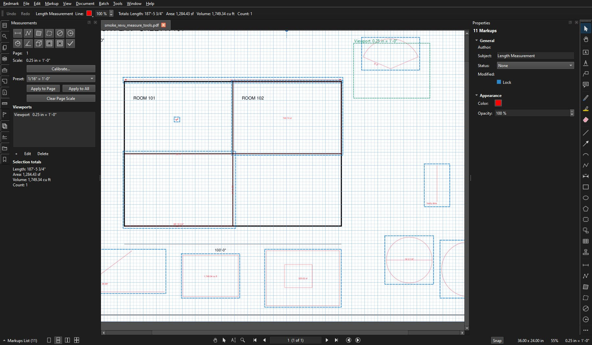
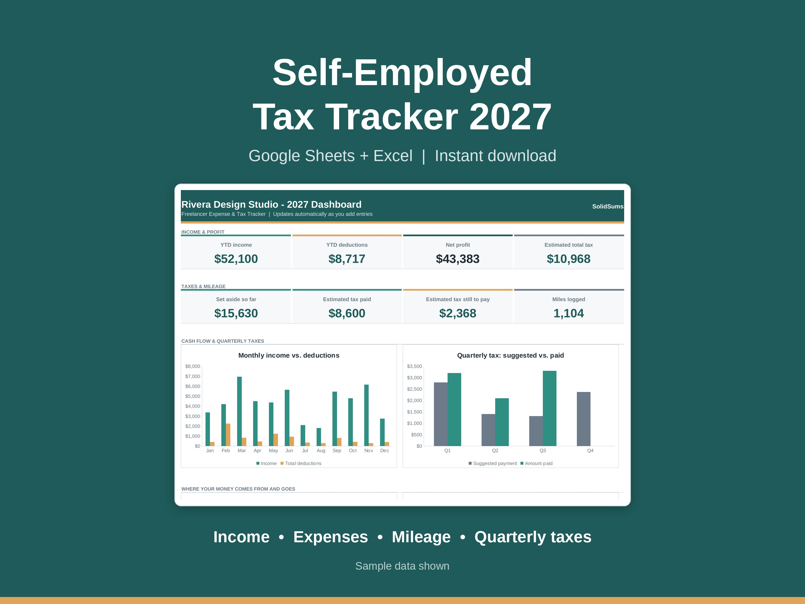

### Hi, I build desktop apps and tools with an AI pair 👋

Construction project manager by day. This profile is a **showroom**: screenshots, demo clips and build journals. Source code stays private.

🌐 **Full portfolio:** https://mfischerapps.github.io

---

#### Featured

| | Project | What it is | Status |
|---|---|---|---|
| 📐 | **[Redmark](https://mfischerapps.github.io/#redmark)** | PDF markup + quantity takeoff for construction drawings (Windows) | Daily driver · 490 commits |
| 📊 | **[SolidSums](https://mfischerapps.github.io/#solidsums)** | Spreadsheet templates for freelancers, drivers, resellers | Live on Etsy |

  
  

#### Latest from the build journal
- **Nov 22** — SolidSums' first product goes live
- **Nov 22** — Redmark: three weeks, 490 commits

